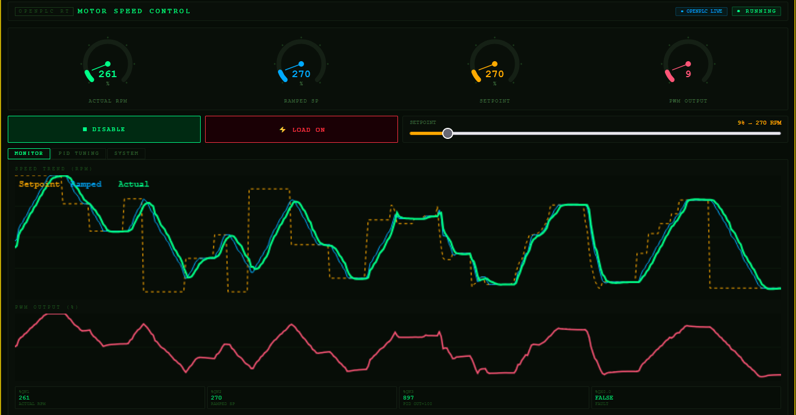
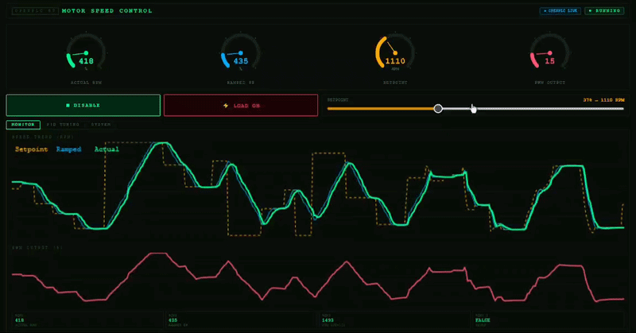
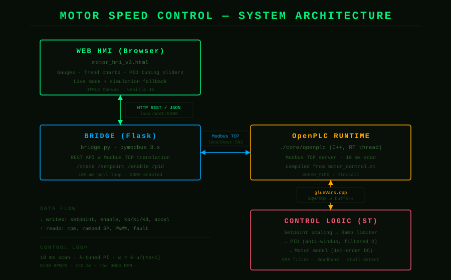
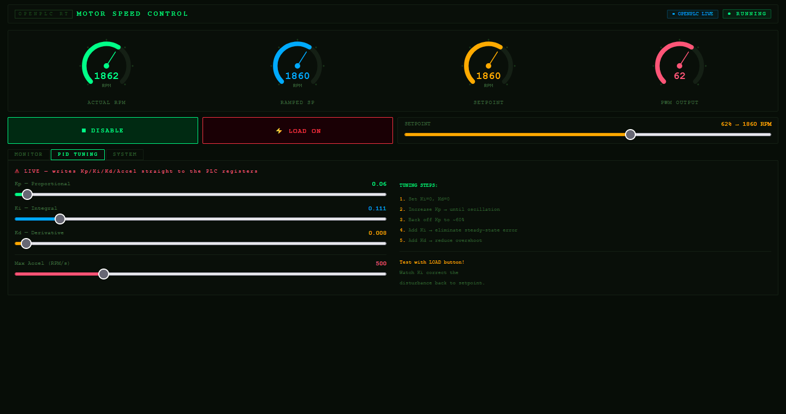
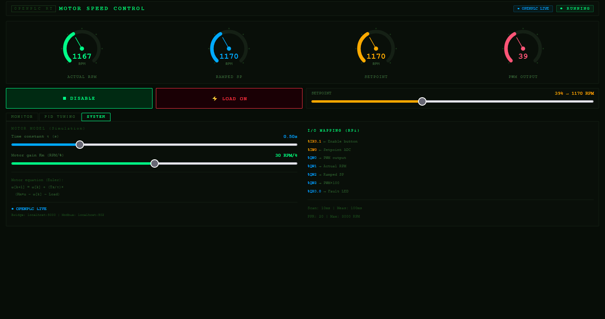

# PMDC Motor PID Speed Control with OpenPLC, Modbus and a Web HMI

A closed-loop PMDC motor speed controller built on [OpenPLC](https://github.com/thiagoralves/OpenPLC_v3),
with a Python bridge that exposes the runtime over REST and a browser-based HMI for live
monitoring and PID tuning. The motor itself is simulated *inside* the PLC, so the plant, the
controller and the operator interface all run together as one self-contained system.

Built as a learning project to understand the full stack: **Modbus, HMI design, PLC
programming (IEC 61131-3 Structured Text), and PID control**.



*Live demo of setpoint changes, ramp-limited tracking and disturbance rejection:*



Try the HMI in your browser at <https://1337leets.github.io/PMDC-Motor-PID-Control-Modbus-HMI-OpenPLC/hmi/motor_hmi_v3.html>.
Without the bridge and the PLC it runs in simulation mode, using its JavaScript copy of the control loop.

## What it does

- A first-order PMDC motor model runs in Structured Text on the OpenPLC runtime.
- A **PI-based controller** (lambda-tuned), with anti-windup and a small filtered
  derivative term, regulates the simulated motor speed toward an operator setpoint.
- A **ramp limiter** smooths the setpoint so the controller never sees a step input.
  The operator can move the slider as fast as they like, and the motor follows at a safe rate.
- A **Flask bridge** translates between the HMI's REST/JSON calls and the runtime's
  Modbus TCP registers.
- A **web HMI** shows live gauges and trend charts, and lets you retune Kp, Ki, Kd and the
  ramp rate *while the motor is running*. The new values are written straight into PLC registers.
- The HMI also runs a JavaScript copy of the same control loop, so it stays useful as a
  **simulation** even when the bridge or the PLC isn't connected.

## Architecture



```
Web HMI  ──HTTP/JSON (5000)──►  Bridge  ──Modbus TCP (502)──►  OpenPLC runtime  ──►  ST control logic
  (browser)                     (Flask)                        (C++ binary)          (PID + motor model)
```

The system has four layers and three boundaries between them. Each boundary speaks a different
protocol, and getting them to agree on a shared address map is most of the work.

## Control design

The plant is a first-order PMDC motor:

```
τ · dω/dt + ω = K · u          K = 30 RPM/%PWM,  τ = 0.5 s,  ω_max = 3000 RPM
```

It is discretised with forward Euler at a 10 ms scan time.

The controller is tuned with **lambda (IMC) tuning** rather than trial and error. For a
first-order plant `G(s) = K/(τs+1)`, a PI controller gives a first-order *closed* loop,
which by construction has no overshoot. The single design knob is λ, the closed-loop time
constant:

```
Kp = τ / (K · λ)        Ti = τ        (Ki = Kp / Ti in the code's integral form)
```

With λ = 0.3 s, a balanced and slightly brisk choice, the PI gains come out to roughly
`Kp = 0.056` and `Ki = 0.111`. A small derivative term (`Kd = 0.008`) is added on top. It is
not required for a first-order plant, but it sharpens disturbance rejection, for example
when a load is applied. The result is a PI design with a light, filtered D.

The PID block includes several practical refinements beyond the textbook form:

- **Conditional-integration anti-windup.** The integral only accumulates while the PWM
  output is unsaturated, so it can't wind up against the 0 to 100 % limit.
- **Filtered derivative on measurement.** The derivative acts on the filtered measured
  speed rather than on the error, which removes the "derivative kick" when the setpoint jumps.
- **EMA measurement filter.** A single-pole low-pass filter on the speed feedback removes
  step-to-step numerical noise before it reaches the controller.
- **Deadband.** Inside ±3 RPM the integral is frozen, so the output sits perfectly still
  at steady state.
- **Stall detection.** A `TON` timer raises a fault and cuts PWM if the motor fails to
  spin while commanded to.

## Register map

This table is the contract between the HMI, the bridge and the PLC. All three layers must agree on it.

| ST variable      | IEC address | Modbus register | Direction   | Scaling   |
|------------------|-------------|-----------------|-------------|-----------|
| `pwm_output`     | `%QW0`      | Holding reg 0   | PLC to HMI  | direct    |
| `display_rpm`    | `%QW1`      | Holding reg 1   | PLC to HMI  | direct    |
| `display_target` | `%QW2`      | Holding reg 2   | PLC to HMI  | direct    |
| `display_pid_out`| `%QW3`      | Holding reg 3   | PLC to HMI  | × 100     |
| `setpoint_raw`   | `%QW4`      | Holding reg 4   | HMI to PLC  | 0 to 32767 |
| `kp_raw`         | `%QW5`      | Holding reg 5   | HMI to PLC  | × 1000    |
| `ki_raw`         | `%QW6`      | Holding reg 6   | HMI to PLC  | × 1000    |
| `kd_raw`         | `%QW7`      | Holding reg 7   | HMI to PLC  | × 1000    |
| `accel_raw`      | `%QW8`      | Holding reg 8   | HMI to PLC  | direct    |
| `fault_led`      | `%QX0.0`    | Coil 0          | PLC to HMI  | bool      |
| `enable_btn`     | `%QX0.1`    | Coil 1          | HMI to PLC  | bool      |

REAL parameters (Kp, Ki and Kd) are carried as integers scaled by 1000, since Modbus registers are
16-bit integers. The HMI multiplies before sending, and the PLC divides on read.

## Repository layout

```
.
├── plc/
│   └── motor_control.st       IEC 61131-3 Structured Text control program
├── bridge/
│   └── bridge.py              Flask and pymodbus bridge between REST and Modbus
├── hmi/
│   └── motor_hmi_v3.html      Self-contained web HMI (no build step)
├── docs/
│   ├── architecture.svg
│   └── screenshot.png
├── requirements.txt
└── README.md
```

## Setup

> Tested on Kali Linux under WSL2 with Python 3.13. OpenPLC v3 is a prerequisite, and this
> repo contains only the application code that runs *on top of* it.

### 1. Install OpenPLC v3

Follow the upstream instructions at https://github.com/thiagoralves/OpenPLC_v3.
After install, the runtime lives under `~/OpenPLC_v3/webserver/`.

### 2. Load the control program

Copy the ST file into OpenPLC's program folder, then compile it:

```bash
cp plc/motor_control.st ~/OpenPLC_v3/webserver/st_files/
cd ~/OpenPLC_v3/webserver
./scripts/compile_program.sh motor_control.st
```

Wait for `Compilation finished successfully!`. You can also upload it through the web UI
under **Programs**, **Upload Program**, then **Launch program**.

### 3. Start the runtime

```bash
cd ~/OpenPLC_v3
sudo ./start_openplc.sh
```

`sudo` is needed on WSL2 for real-time scheduling (`SCHED_FIFO`, `mlockall`) and to bind
port 502. The dashboard is at http://localhost:8080.

### 4. Run the bridge

The bridge needs **pymodbus 3.x**, which is newer than the 2.5.3 that OpenPLC pins. It
therefore gets its own virtual environment, so the runtime's web server keeps working:

```bash
python3 -m venv bridge-venv
./bridge-venv/bin/pip install -r requirements.txt
./bridge-venv/bin/python bridge/bridge.py
```

You should see `Connected to OpenPLC on localhost:502`.

### 5. Open the HMI

Open `hmi/motor_hmi_v3.html` in a browser. When the bridge is reachable the badge reads
`OPENPLC LIVE`, and otherwise it falls back to `SIMULATION` mode.

## Usage

1. Press **ENABLE**. The motor won't turn on a setpoint alone, because enable is a separate safety gate.
2. Drag the **SETPOINT** slider and watch the actual speed ramp up to track it.
3. Open the **PID TUNING** tab and move Kp, Ki, Kd or the accel limit. Changes take effect
   on the next scan. Try cranking Kp up to see oscillation, or setting Ki to zero to see the
   steady-state error return.
4. Toggle **LOAD ON** to inject a disturbance and watch the controller reject it.

PID changes made in the HMI live in PLC RAM only, and they reset to the values baked into
`motor_control.st` on restart. Once you find values you like, edit the initial values in the
ST file and recompile to make them the new defaults.

| PID tuning tab | System / motor model tab |
|----------------|--------------------------|
|  |  |


## Common issues

These are the problems I ran into while building this, written down so you don't have to.

- **Dashboard says "Running" but your code never executes.** OpenPLC v3 compiles the ST
  program *into* the `./core/openplc` binary. `Start PLC` does not recompile, it just runs
  whatever binary is on disk. After any `.st` change you must recompile (Launch program or
  `compile_program.sh`) **and** stop and start the runtime. Verify with
  `strings core/openplc | grep <a_variable_name>`.

- **`cannot import name 'ModbusTcpClient'`.** The bridge uses pymodbus 3.x, while OpenPLC's venv
  has 2.5.3. Keep them in separate virtual environments (see setup step 4).

- **`error: invalid located variable declaration`.** MatIEC, OpenPLC's ST compiler, dislikes
  mixing located (`AT %QW0`) and unlocated variables in the same `VAR` block. Keep them in
  two separate `VAR ... END_VAR` blocks.

- **Bridge connects but writes do nothing.** The ST address map and the bridge's register
  map have drifted apart. The bridge's header comment is the source of truth, so make the ST
  `AT %…` addresses match it.

- **Runtime won't die or respawns after kill.** OpenPLC installs a `systemd` service that
  restarts it. Run `sudo systemctl stop openplc && sudo systemctl disable openplc`.

- **Steady-state oscillation.** This is usually the derivative term amplifying feedback noise.
  The filtered derivative on measurement, the EMA filter and the deadband in this program
  address it. If you retune, keep Kd small.

- **Steady-state error that never closes.** The integral limit is too low to supply the
  steady-state output. Size `INTEGRAL_LIMIT` so `Ki × limit` can reach 100 % PWM on its own.

## Notes and limitations

- The motor is *simulated in the PLC*. To drive real hardware, replace Block 1 (the motor
  model) with reads from an encoder or ADC and route `pwm_output` to a real PWM channel.
- OpenPLC v3 is end-of-life, and a v4 runtime with dynamic program loading exists. This
  project targets v3.
- WSL2 can add scheduling jitter, so the 10 ms scan may occasionally stretch. That is fine for
  this loop, but not for hard real-time control.

## License

Apache-2.0, see [LICENSE](LICENSE). OpenPLC itself is GPLv3 and is not included here.
